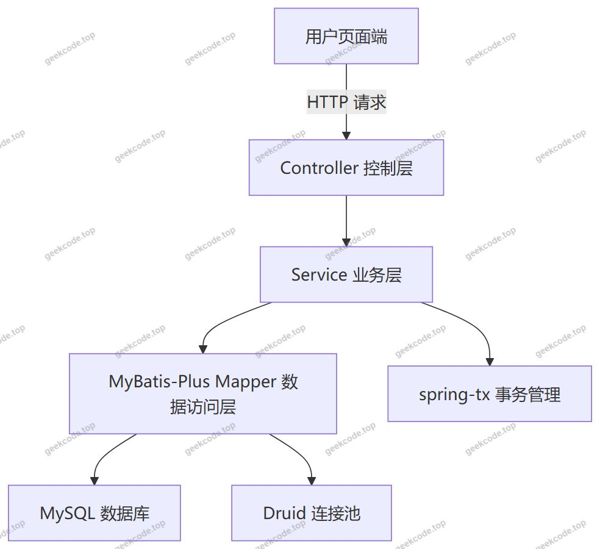
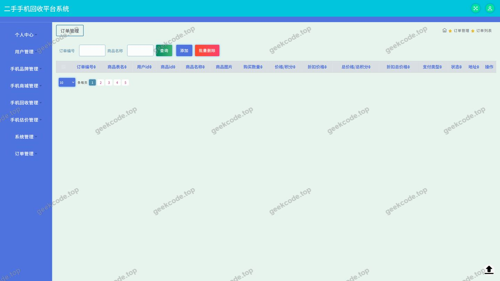
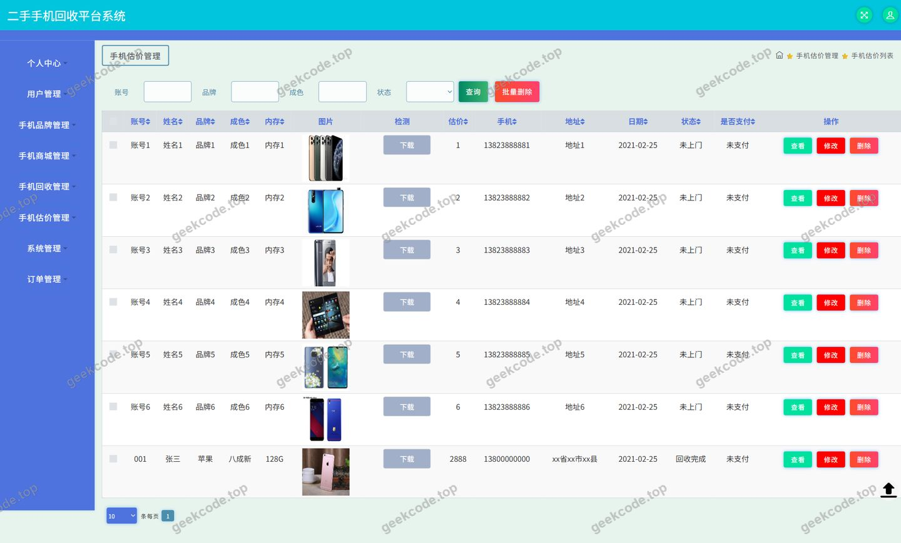
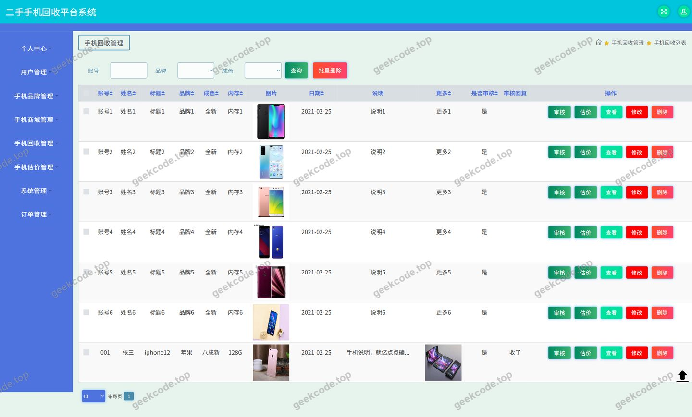
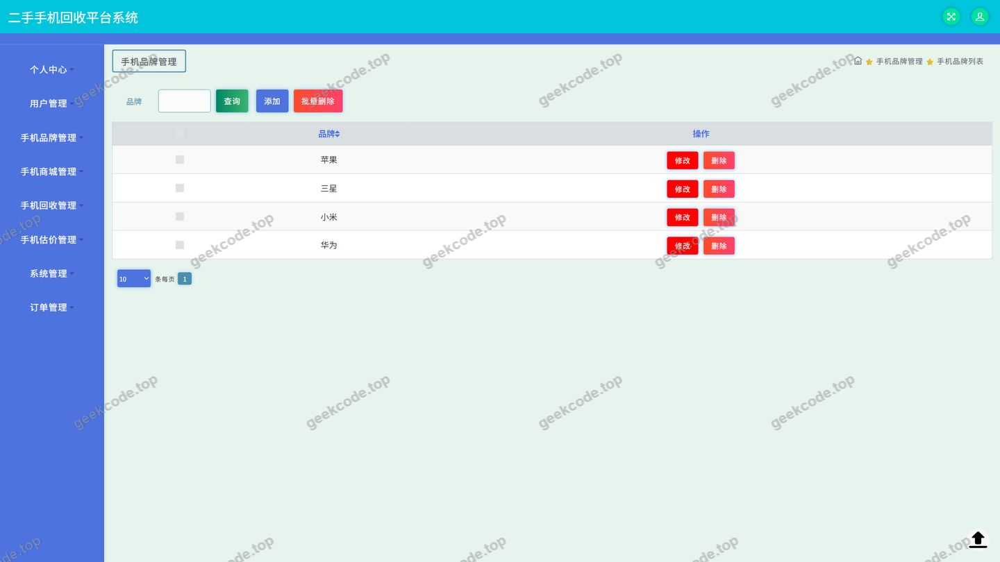
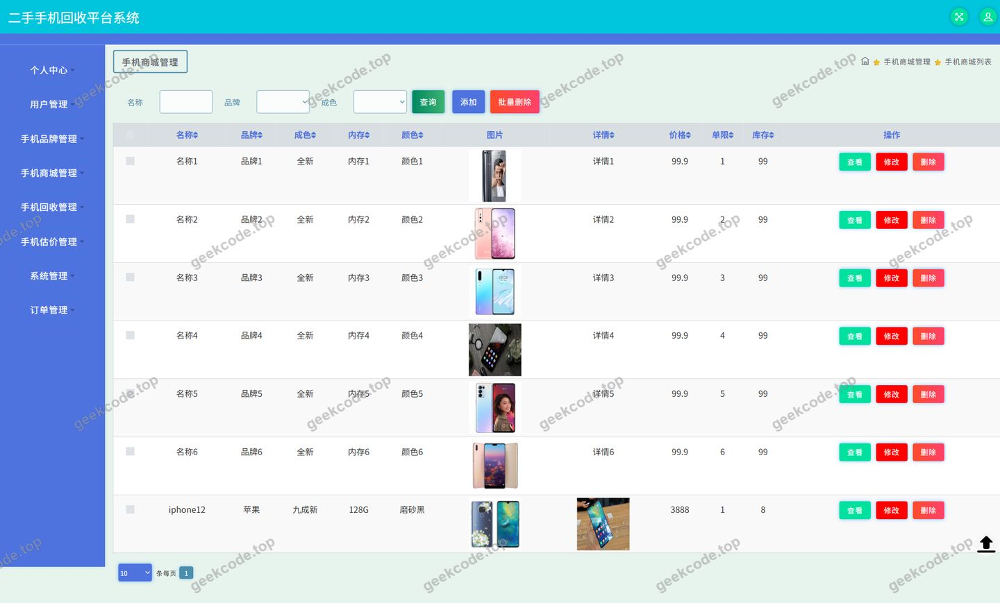
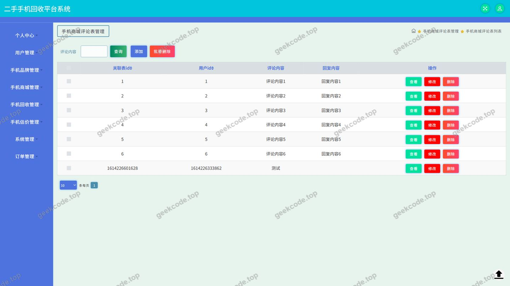
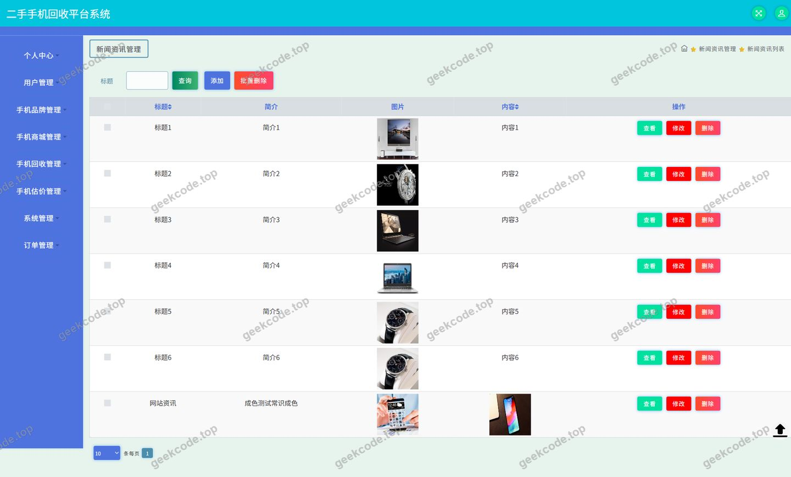
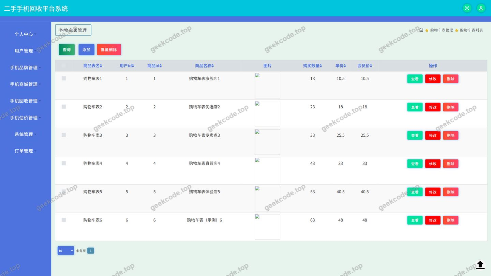

# java毕业设计ssm二手手机回收平台系统-计算机毕业设计

> 🎓 **计算机毕业设计 · java毕业设计ssm二手手机回收平台系统-计算机毕业设计**
>
> 本仓库只放**项目介绍 + 运行截图**（截图是站点带水印的原图，存在仓库 `images/` 里）。
>
> 👉 **完整可运行源码 / 数据库脚本 / 部署文档：[点我获取](https://geekcode.top/archives/java%E6%AF%95%E4%B8%9A%E8%AE%BE%E8%AE%A1ssm%E4%BA%8C%E6%89%8B%E6%89%8B%E6%9C%BA%E5%9B%9E%E6%94%B6%E5%B9%B3%E5%8F%B0%E7%B3%BB%E7%BB%9F-%E8%AE%A1%E7%AE%97%E6%9C%BA%E6%AF%95%E4%B8%9A%E8%AE%BE%E8%AE%A1?utm_source=github)**
>
> 💬 咨询微信：**ir9372**　|　🌐 更多项目：[极客代码 geekcode.top](https://geekcode.top/?utm_source=github)
>
> 📌 项目详情页：<https://geekcode.top/archives/java%E6%AF%95%E4%B8%9A%E8%AE%BE%E8%AE%A1ssm%E4%BA%8C%E6%89%8B%E6%89%8B%E6%9C%BA%E5%9B%9E%E6%94%B6%E5%B9%B3%E5%8F%B0%E7%B3%BB%E7%BB%9F-%E8%AE%A1%E7%AE%97%E6%9C%BA%E6%AF%95%E4%B8%9A%E8%AE%BE%E8%AE%A1?utm_source=github>

<table><td width="230" align="center"> <b>扫码加微信 ir9372</b></td><td valign="middle">📦 源码 = 项目介绍 + 全部运行截图 + 数据库 + 部署文档 👉 点上方任意截图，直接跳到 <b>极客代码 geekcode.top</b> 详情页</td></table>

---

<h1>java毕业设计ssm二手手机回收平台系统-计算机毕业设计</h1>
<h2>项目概述</h2>

二手手机回收平台系统是一套面向二手手机交易与回收业务的 Java Web 应用，采用 SSM 架构（Spring + Spring MVC + MyBatis-Plus）进行开发。系统围绕&quot;手机商城&quot;与&quot;手机回收&quot;两条主线展开：用户可以在手机商城中浏览在售二手手机、按品牌筛选、查看商品评论；也可以通过手机估价功能对自有手机进行评估，并提交手机回收申请，由平台完成后续回收流程。同时，系统提供新闻资讯栏目用于发布行业动态与平台公告，并通过个人中心支持订单查询、收货地址维护、商品收藏等日常操作。

系统对外以 API 形式提供服务，数据访问层使用 MyBatis-Plus 简化单表 CRUD 与条件查询，数据库连接由 Druid 连接池统一管理。适用于计算机专业毕业设计场景，可用于演示一个结构完整、模块清晰的二手手机垂直电商与回收业务系统。

<h2>技术架构</h2>
<h3>前后端架构</h3>

项目类型为 pure-api，即以 HTTP 接口为核心的服务端应用，业务能力通过 Controller 层统一暴露。系统整体分为表现层（Controller）、业务层（Service）、数据访问层（Mapper）与数据库层四层结构，依赖 spring-web、spring-webmvc 完成请求分发与参数绑定，依赖 spring-context、spring-beans 完成 Bean 的装配与生命周期管理，依赖 spring-tx 提供声明式事务能力。

<h3>数据库设计要点</h3>

根据业务模块划分，数据设计围绕以下主题域组织：

<ul>
<li>用户域：用户账号信息、登录鉴权数据；</li>
<li>商品域：手机品牌、手机商城商品、商品评论；</li>
<li>交易域：订单、收货地址、购物车、用户收藏；</li>
<li>回收域：手机估价、手机回收申请；</li>
<li>内容域：新闻资讯；</li>
<li>支撑域：系统配置、文件资源。</li>
</ul>

各实体之间通过商品编号、用户编号、订单编号等业务主键建立关联关系，具体字段结构根据现有信息无法确定。

<h3>核心技术选型理由</h3>
<ul>
<li><strong>Spring</strong>：通过 IoC 容器统一管理各层对象依赖，通过 AOP 实现日志、事务等横切逻辑与业务代码解耦。</li>
<li><strong>Spring MVC</strong>：作为 Web 层框架，负责 URL 映射、请求参数解析与响应数据封装，支撑项目以 API 形式对外提供服务。</li>
<li><strong>MyBatis-Plus</strong>：在 MyBatis 基础上提供通用 Mapper 与条件构造器，减少重复 SQL 编写，提升数据访问层开发效率。</li>
<li><strong>Druid</strong>：提供数据库连接池能力，具备连接复用与监控统计特性，提升数据库访问的稳定性。</li>
<li><strong>JUnit</strong>：用于业务逻辑与数据访问层的单元测试验证。</li>
</ul>
<h2>功能模块</h2>
<h3>用户端功能模块</h3>

依据前台导航菜单（手机商城、新闻资讯）与个人中心菜单（个人中心、我的订单、我的地址、我的收藏），用户端主要包含以下模块：

<ul>
<li><strong>手机商城</strong>：展示在售二手手机商品列表，支持商品浏览与详情查看，是用户选购手机的核心入口。</li>
<li><strong>新闻资讯</strong>：展示平台发布的资讯类内容，用于行业动态与平台信息的传递。</li>
<li><strong>手机估价</strong>：用户提交待回收手机的相关信息以获取估价结果，为回收决策提供依据。</li>
<li><strong>手机回收</strong>：在估价基础上提交手机回收申请，是平台回收业务的核心入口。</li>
<li><strong>登录</strong>：提供用户身份认证入口，是进入个人中心与交易类功能的前提。</li>
<li><strong>个人中心</strong>：用户个人信息与账户相关操作的汇总页面。</li>
<li><strong>我的订单</strong>：查看与当前用户相关的订单记录。</li>
<li><strong>我的地址</strong>：维护收货地址信息，为订单履约提供地址数据支撑。</li>
<li><strong>我的收藏</strong>：查看用户收藏的商品内容。</li>
</ul>
<h3>服务端接口模块</h3>

依据 Controller 列表，服务端提供以下接口模块：

<ul>
<li><strong>ShoujishangchengController（手机商城）</strong>：手机商城商品的接口能力，对应商城列表与详情等操作。</li>
<li><strong>ShoujipinpaiController（手机品牌）</strong>：手机品牌数据的接口能力，为商城商品提供品牌维度支持。</li>
<li><strong>ShoujigujiaController（手机估价）</strong>：手机估价业务的接口能力。</li>
<li><strong>ShoujihuishouController（手机回收）</strong>：手机回收业务的接口能力。</li>
<li><strong>DiscussshoujishangchengController（手机商城评论）</strong>：手机商城商品评论的接口能力，对应截图中的&quot;手机商城评论&quot;页面。</li>
<li><strong>OrdersController（订单）</strong>：订单相关业务的接口能力，对应截图中的&quot;订单&quot;页面。</li>
<li><strong>AddressController（地址）</strong>：收货地址管理的接口能力。</li>
<li><strong>CartController（购物车）</strong>：购物车管理的接口能力。</li>
<li><strong>NewsController（新闻资讯）</strong>：新闻资讯内容的接口能力。</li>
<li><strong>FileController（文件）</strong>：文件上传、下载等资源操作的接口能力。</li>
<li><strong>CommonController（通用）</strong>：通用性接口能力，为各模块提供公共支撑。</li>
<li><strong>ConfigController（配置）</strong>：系统配置数据的接口能力。</li>
</ul>

个人中心菜单中的&quot;我的收藏&quot;未在 Controller 列表中体现为独立控制器，其具体实现方式根据现有信息无法确定。

<h3>管理端功能模块</h3>

项目未配置后台路由，管理端页面的菜单结构与功能范围根据现有信息无法确定。截图中的&quot;页面-用户&quot;&quot;页面-手机品牌&quot;&quot;页面-手机商城&quot;&quot;页面-新闻资讯&quot;&quot;页面-订单&quot;&quot;页面-手机估价&quot;&quot;页面-手机回收&quot;&quot;页面-手机商城评论&quot;等页面体现了系统具备相应的数据查看与管理能力，其具体的角色归属与操作权限根据现有信息无法确定。

<h2>用户角色与权限</h2>

根据现有信息，系统中可确定存在以下角色与功能划分：

<h3>普通用户</h3>
<ul>
<li>可通过登录页面完成身份认证；</li>
<li>可访问手机商城，浏览二手手机商品并查看商品评论；</li>
<li>可查看新闻资讯内容；</li>
<li>可使用手机估价功能提交估价需求；</li>
<li>可提交手机回收申请；</li>
<li>可进入个人中心查看和维护个人信息；</li>
<li>可查看我的订单；</li>
<li>可维护我的地址；</li>
<li>可查看我的收藏。</li>
</ul>
<h3>管理员</h3>

现有信息未提供后台路由配置，管理员的账号体系、登录入口与可访问功能菜单无法确定。截图中出现&quot;页面-用户&quot;等页面，表明系统存在与之对应的页面形态，但该页面归属的角色及其具体操作权限根据现有信息无法确定。

<h2>项目特色与创新点</h2>
<ul>
<li><strong>业务闭环清晰</strong>：将&quot;手机估价—手机回收&quot;与&quot;手机商城—下单交易&quot;两条业务链路在同一系统中打通，覆盖二手手机从回收到再销售的完整场景，避免了单一功能模块的割裂。</li>
<li><strong>模块职责分明</strong>：Controller 层按业务域细分为手机商城、手机品牌、手机估价、手机回收、商城评论、订单、地址、购物车、新闻资讯、文件、配置、通用等模块，便于后续扩展与维护。</li>
<li><strong>数据访问效率优化</strong>：引入 MyBatis-Plus 的条件构造能力，减少重复的数据访问代码，配合 Druid 连接池提升数据库访问的稳定性。</li>
<li><strong>分层解耦</strong>：依托 Spring 的容器管理与 AOP 能力，业务逻辑、事务控制与数据访问相互解耦，代码结构规范，符合毕业设计对工程规范性的要求。</li>
<li><strong>内容与交易结合</strong>：在交易功能之外提供新闻资讯栏目，形成内容运营与交易转化的结合点。</li>
</ul>
<h2>部署环境</h2>
<ul>
<li><strong>JDK</strong>：Spring 相关依赖需要 Java 运行环境支持，具体 JDK 版本在现有信息中未明确。</li>
<li><strong>MySQL</strong>：作为系统的主数据库，存储用户、商品、订单、回收、资讯等业务数据。</li>
<li><strong>Maven</strong>：用于项目依赖管理与构建，需依据项目依赖清单拉取 spring-core、spring-context、spring-web、spring-webmvc、spring-jdbc、spring-tx、spring-aop、spring-beans、spring-context-support、MyBatis-Plus、Druid、JUnit 等构件。</li>
<li><strong>Servlet 容器</strong>：项目依赖 spring-web 与 spring-webmvc，需运行于支持 Servlet 规范的 Web 容器中，具体容器类型在现有信息中未明确。</li>
<li><strong>Druid 连接池配置</strong>：需配置数据库连接地址、账号、密码等连接参数。</li>
<li><strong>前端运行环境</strong>：项目类型为 pure-api，前端页面的具体工程形态与运行环境根据现有信息无法确定。</li>
<li><strong>Node.js / 微信开发者工具</strong>：现有信息中未涉及相关依赖，不属于本项目所需环境。</li>
</ul>
<h2>五、技术特性</h2>
<ul>
<li>使用 MyBatis-Plus 简化数据访问层开发</li>
</ul>
<h2>六、功能模块截图</h2>
<h3>后台管理端</h3>
<h4>页面-登录</h4>

<h4>页面-订单</h4>

<h4>页面-手机估价</h4>

<h4>页面-手机回收</h4>

<h4>页面-手机品牌</h4>

<h4>页面-手机商城</h4>

<h4>页面-手机商城评论</h4>

<h4>页面-新闻资讯</h4>

<h4>页面-用户</h4>

---

## 获取完整源码

| 项目 | 说明 |
| --- | --- |
| 项目名 | java毕业设计ssm二手手机回收平台系统-计算机毕业设计 |
| 运行截图 | 本文 10 张（站点带水印原图，仓库 `images/` 目录） |
| 完整源码 | [https://geekcode.top/archives/java%E6%AF%95%E4%B8%9A%E8%AE%BE%E8%AE%A1ssm%E4%BA%8C%E6%89%8B%E6%89%8B%E6%9C%BA%E5%9B%9E%E6%94%B6%E5%B9%B3%E5%8F%B0%E7%B3%BB%E7%BB%9F-%E8%AE%A1%E7%AE%97%E6%9C%BA%E6%AF%95%E4%B8%9A%E8%AE%BE%E8%AE%A1?utm_source=github](https://geekcode.top/archives/java%E6%AF%95%E4%B8%9A%E8%AE%BE%E8%AE%A1ssm%E4%BA%8C%E6%89%8B%E6%89%8B%E6%9C%BA%E5%9B%9E%E6%94%B6%E5%B9%B3%E5%8F%B0%E7%B3%BB%E7%BB%9F-%E8%AE%A1%E7%AE%97%E6%9C%BA%E6%AF%95%E4%B8%9A%E8%AE%BE%E8%AE%A1?utm_source=github) |
| 咨询微信 | **ir9372**（备注：jingpin-yuanma） |
| 更多项目 | [极客代码 geekcode.top](https://geekcode.top/?utm_source=github) |

> 需要源码、部署、改配置、跑不起来等问题，加微信 ir9372 沟通，说明项目名即可。
